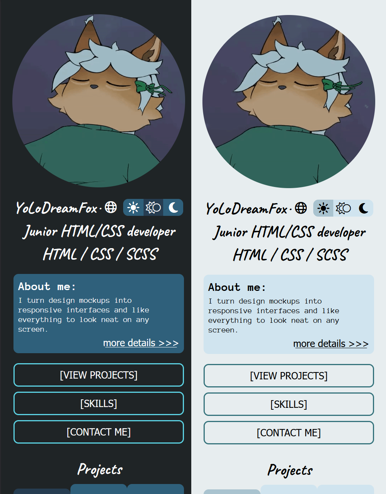

# YoLoDreamFox — HTML/CSS developer portfolio

A responsive portfolio page for a junior HTML/CSS developer: projects, skills, experience and contacts.
Hand-coded in HTML and SCSS; all content is loaded from data files.

Русская версия: [Readme.md](Readme.md)

**Demo:** https://yolodreamfox.github.io/portfolio/



## Features

- Responsive layout: desktop and mobile versions
- Light and dark themes: the system setting is used by default, and the user's choice is remembered
- Language switch (Russian / English): texts are stored in YAML files
- Content separated from markup: projects, skills and experience are rendered from `data.js`
- Experience is sorted from newest to oldest, and the length of each job is calculated automatically
- Skill bars and their animation are built with CSS
- Skill cards scroll with arrow buttons; the buttons appear only when the cards don't fit
- The "About me" window is built on the `<dialog>` element

## Stack

HTML5, SCSS (Sass), JavaScript (ES modules, no frameworks), js-yaml, Font Awesome.
Fonts: Caveat, Anonymous Pro.

## Project structure

```
├── index.html
├── css/            compiled styles
├── scss/           style sources (mixins, animations, themes)
├── js/             modules: card rendering, translations, theme, observers
├── data/
│   ├── data.js     projects, skills, experience
│   ├── picture/    work screenshots, avatar
│   └── locales/    ru.yaml, en.yaml
└── libs/           js-yaml, Font Awesome, fonts
```

## Running locally

1. Clone the repository.
2. Start a local server. ES modules and `fetch` don't work when `index.html` is opened by double-clicking it.
   The Live Server extension for VS Code or `python -m http.server` in the project folder will do.
3. Open `http://localhost:8000` (or the address Live Server shows).

## Building styles

Styles are compiled with the Watch Sass extension for VS Code. The compiled CSS is in the repository, so no build is needed just to view the page.

## How to change the content

- **Project.** Add an object to the `projects` array in `data.js` (id, picture, names and description key, stack, links), add a tab in the markup, and add a key to the translation files.
- **Skill.** Add an entry to the right group in `data.js`: a name and a level from 0 to 100.
- **Experience.** Add a job with start and end dates. For a current job, the end date is `null`.
- **Interface text.** Edit `data/locales/ru.yaml` and `data/locales/en.yaml`. The keys match the `data-i18n` attributes in the markup.

## Deployment

The page is hosted on GitHub Pages (Settings → Pages → `main` branch, repository root).

## Credits and licenses

- [js-yaml](https://github.com/nodeca/js-yaml): MIT
- The button hover effect is based on a public example found online; the original source was not saved
- Fonts: Caveat (SIL OFL), Anonymous Pro (SIL OFL)

## License

© 2026 YoLoDreamFox. All rights reserved.
The code is published for viewing. Permission from the author is required to use it in other projects.